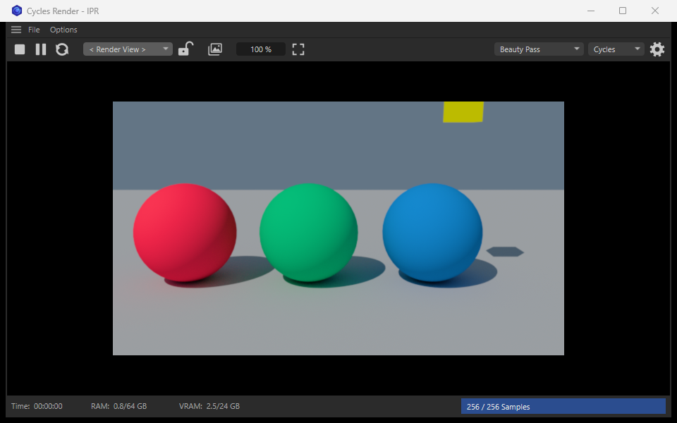
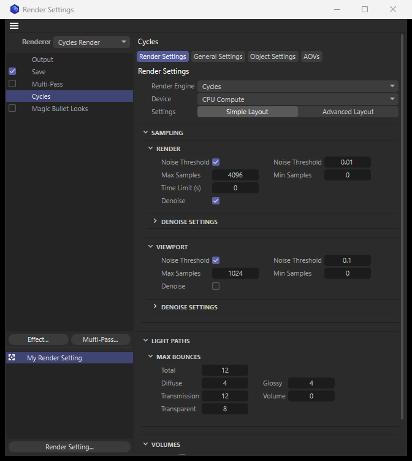
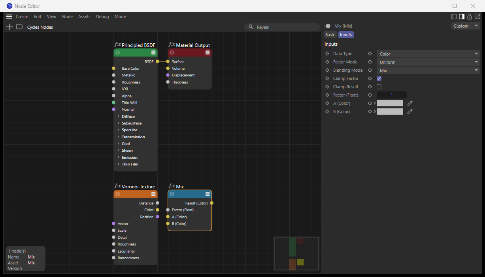

# Cycles Render for Cinema 4D

A render engine plugin for Cinema 4D 2027 that renders the Cinema 4D scene with Blender's **Cycles** and **Eevee**. It drives an unmodified Blender 5.2 in the background: the plugin reads the scene, a small bridge inside Blender rebuilds it, and the picture comes back into the Picture Viewer or into a live render window.


> **Status: pre-release (current: 0.1.0).** Final frames and the live render window work end to end on Windows. Some features are approximations and a few are missing; see [docs/roadmap.md](docs/roadmap.md).
>
> **Windows only.** The plugin has not been built or tested for macOS.

## What it does

- **A renderer in the Render Settings.** Choose "Cycles Render", pick Cycles or Eevee, and render stills and animations to the Picture Viewer, with render passes as multi-pass layers (also motion vectors, object and material index, shadow catcher), motion blur, the render region and denoising. An Output tab sets the resolution, its percentage and the pixel aspect as Blender's Output tab does.
- **A live render window (IPR).** It follows every change of the scene and sends only what changed; meshes that did not change are not even exported again. It follows the timeline while it plays, and sends an object or camera moved with a tool to Blender while the drag goes on. Its "Add" menu adds a Cycles Material, a camera with a Cycles Camera tag, a Cycles Light, and the plugin's tags. On a GPU a camera move reaches the screen in about 15 ms and an object edit in 20 to 70 ms (640 × 360); in a scene of 900 meshes and 720,000 polygons the export after moving one object takes about 10 ms.
- **Your Cinema 4D scene as it is.** Meshes with normals, UV sets, vertex maps and vertex colours; materials per polygon selection; instances, Cloners and their clone colours; deformers and animation; cameras in every projection, also the editor's views and the spherical camera; standard and Redshift lights with their include and exclude lists; a Sky object or a Redshift dome light; volumes (Volume Builder, Volume Loader); hair; particles.
- **Materials three ways.**
  - Cinema 4D's classic materials and shaders are translated to Blender nodes, or baked to textures where Blender has no counterpart.
  - Redshift Standard Materials are read option by option, with the textures, math, colour mix and colour correction nodes wired into them.
  - **Cycles nodes**: a node space in Cinema 4D's Node Editor with one node per Blender shader node, carried to Blender one to one.
- **A Cycles Object tag** for what Cinema 4D has no place for: ray visibility with holdout and shadow catcher, light linking, instances on particles and Matrix objects, and volume shading.
- **Blender's lights, two ways** (two variants to compare): a **Cycles Light** object with Blender's point, sun, spot and area light and all their settings, and a **Cycles Light tag** that gives Cinema 4D's and Redshift's lights Blender's settings.
- **Blender's render devices in the Preferences:** OptiX, CUDA, HIP, oneAPI or Metal, and which devices the GPU setting uses, as in Blender's own Preferences.
- **A Cycles Camera tag** with Blender's depth of field (focus object, f-stop, aperture blades, rotation and ratio) and lens: perspective, orthographic or panoramic (equirectangular, fisheye and the other panoramas of Cycles).

| Live render window | Render Settings | Cycles nodes |
|---|---|---|
|  |  |  |

## Requirements

- Windows 10 or 11, 64-bit. (macOS is not supported yet; the platform code is isolated for a port.)
- Cinema 4D 2027.
- Blender 5.2, installed normally. It is free: <https://www.blender.org/download/>.
- A graphics card that Cycles supports is recommended; rendering on the CPU works.

## Install

A release consists of two parts, one for each application. Take both from the same release.

1. **The Blender bridge**: `cycles_render_bridge-<version>.zip`. In Blender, open *Edit > Preferences > Get Extensions*, choose *Install from Disk…* from the menu at the top right, and pick the .zip. Close Blender again; it does not need to be running.
2. **The Cinema 4D plugin**: `CyclesRender-<version>-C4D2027-win64.zip`. Unpack it into a plugins folder of Cinema 4D, for example the `plugins` folder inside the folder that *Edit > Preferences > Open Preferences Folder…* opens, so that it contains `plugins/cyclesrender/cyclesrender.xdl64`. Restart Cinema 4D.

On its first start the plugin looks for Blender 5.2 in its usual place and remembers it. If yours is somewhere else, choose `blender.exe` in *Edit > Preferences > Renderer > Cycles Render*.

**Updating:** in Blender, unfold *Cycles Render Bridge* under *Edit > Preferences > Add-ons* and press *Uninstall*, then install the new .zip; in Cinema 4D, replace the `cyclesrender` folder. Take both parts from the same release.

## Quick start

1. Open a scene, or `examples/cycles_render_examples.c4d` from this repository.
2. In the Render Settings choose the renderer **Cycles Render**.
3. Render to the Picture Viewer, or open the live render window with *Extensions > Cycles Render IPR* and press Start.

New node materials are made in the "Cycles" node space while Cycles Render is the renderer. Their thumbnails are rendered by Blender. Anything in the scene that cannot be translated is named in Cinema 4D's console instead of being dropped silently.

## How it works

```
Cinema 4D process                                Blender process
┌──────────────────────────────────────────┐     ┌──────────────────────────────────────────┐
│ renderer (VideoPost) ────────────────┐   │     │ bridge (Python)                          │
│ IPR window ─ controller ─ worker ────┼───┼─TCP─┼─ protocol → scene builders (bpy)         │
│ scene exporter + delta sync              │     │ viewport driver | final driver           │
│ material translators → node graphs       │◄─SHM┼─ frame block (float pixels) + progress   │
└──────────────────────────────────────────┘     └──────────────────────────────────────────┘
```

The plugin (C++) knows Cinema 4D and translates everything into Blender's terms. The bridge (Python, inside Blender) applies what it is sent and runs the render; it knows nothing about Cinema 4D. They talk over a local socket; live frames come back through shared memory. The two are separate programs, which is also what keeps the GPL-licensed bridge apart from the plugin. [docs/architecture.md](docs/architecture.md) has the whole design and the reason for each decision.

## Repository layout

| Folder | What it holds |
|---|---|
| [`plugin/`](plugin/) | The Cinema 4D plugin (C++): `plugin/cyclesrender`, a module of the Cinema 4D SDK |
| [`bridge/`](bridge/) | The Blender bridge (Python): a Blender extension that contains the package `c4d_bridge` |
| [`protocol/`](protocol/protocol.md) | The wire protocol between the two |
| [`tools/`](tools/) | Build script, release packaging, and the generators for the settings page, the nodes and the icons |
| [`docs/`](docs/) | Architecture, development guide, roadmap, and reference notes on Blender and the Cinema 4D SDK |
| [`examples/`](examples/) | An example scene that shows the supported cases |
| [`release/`](release/) | Where release packages are built (only its README is in the repository) |

## Building from source

You need Visual Studio with the C++ workload, CMake 3.30 or newer, the Cinema 4D 2027 C++ SDK, and Blender 5.2.

```powershell
.\tools\build_plugin.ps1 -Sdk <folder of the unpacked Cinema 4D SDK>
& "C:\Program Files\Maxon Cinema 4D 2027\Cinema 4D.exe" `
    "g_additionalModulePath=<repo>\build\plugin\bin\Release\plugins" `
    "g_cyclesRenderBridge=<repo>\bridge\c4d_bridge\main.py"
```

The second command starts Cinema 4D with the freshly built plugin and the bridge straight from the repository, with nothing installed. [docs/development.md](docs/development.md) covers the set-up, the tests, the development settings and how to add a feature. Contributors, human or AI, should start with [AGENTS.md](AGENTS.md).

## Licence

- `bridge/` is licensed under the **GNU General Public License v3.0 or later** ([bridge/LICENSE](bridge/LICENSE)), because it runs inside Blender and uses its Python API.
- Everything else (`plugin/`, `protocol/`, `tools/`, `docs/`, `examples/`) is licensed under the **Apache License 2.0** ([LICENSE](LICENSE)). The exception is the two scripts in `tools/` that run inside Blender (`dump_blender_nodes.py`, `make_native_placeholder.py`), which are GPL-3.0-or-later like the bridge.

Every source file names its licence in its first lines (`SPDX-License-Identifier`). The plugin and the bridge are separate programs that only exchange data.

## Acknowledgements

Cycles and Eevee are render engines of [Blender](https://www.blender.org), developed by the Blender Foundation and its community. Cinema 4D and Redshift are products of Maxon. This project is independent of both and is not endorsed by either.

Support Blender: [fund.blender.org](https://fund.blender.org/)
