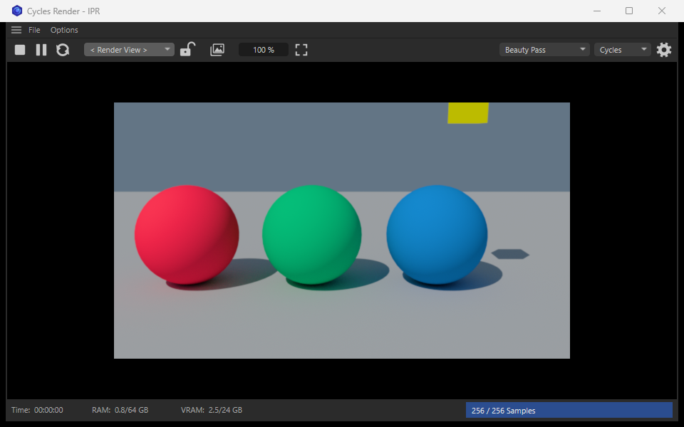
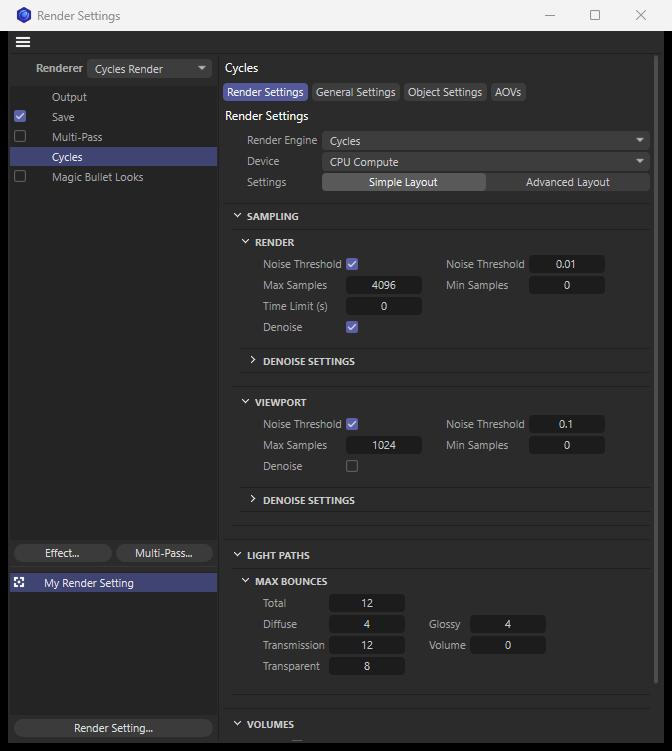

# Architecture

How Cycles Render is built, and the reason behind each decision. Read this before changing how the parts work together. Exact identifiers and measured facts are in [reference/blender.md](reference/blender.md) and [reference/c4d-sdk.md](reference/c4d-sdk.md); the message format is in [../protocol/protocol.md](../protocol/protocol.md); what works and what is open is in [roadmap.md](roadmap.md).

## Contents

- [The product](#the-product)
- [Vocabulary](#vocabulary)
- [The two programs](#the-two-programs)
- [Source map](#source-map)
- [Design decisions](#design-decisions)
- [Final frames](#final-frames)
- [The IPR](#the-ipr)
- [The IPR window](#the-ipr-window)
- [Reading the scene](#reading-the-scene)
- [What becomes what](#what-becomes-what)
- [Materials](#materials)
- [The Render Settings page](#the-render-settings-page)
- [Risks](#risks)

## The product

A render engine plugin for Cinema 4D 2027 that renders the Cinema 4D scene with Blender's Cycles and Eevee engines by driving a Blender 5.2 process. It provides:

- a renderer that can be chosen in the Render Settings, with its own settings page;
- rendering to the Picture Viewer, including animations and render passes;
- a live render (IPR) window;
- support for the scene as Cinema 4D users build it: meshes and their attributes, materials and shaders, cameras, lights, volumes, MoGraph, deformers and animation.

The first priority of the design is that **the IPR reacts as fast as possible**. Where that conflicted with keeping Blender invisible and headless, responsiveness won.

## Vocabulary

| Term | Meaning |
|---|---|
| Plugin | The C++ module loaded by Cinema 4D (`plugin/cyclesrender`) |
| Bridge | The Python package that runs inside Blender (`bridge/c4d_bridge`) |
| IPR | The interactive render window inside Cinema 4D |
| Viewport driver | The bridge's mode for the IPR: a windowed Blender whose 3D viewport renders live |
| Final driver | The bridge's mode for Picture Viewer renders: a background Blender that does one blocking render per frame |
| Scene item | One thing the plugin sends: a mesh, an object, a light, a material, … Each has a kind and an id |
| Delta | The items that changed since the last request, which is all that is sent |
| SyncState | The plugin's record of what Blender currently holds, used to compute deltas |
| Frame block | The named shared-memory block that carries float pixels from Blender to Cinema 4D |

## The two programs

```
Cinema 4D process                                Blender process
┌──────────────────────────────────────────┐     ┌──────────────────────────────────────────┐
│ VideoPost renderer ──────────────────┐   │     │ bridge (Python)                          │
│ IPR window ─ IprController ─ worker ─┼───┼─TCP─┼─ protocol → scene builders (bpy)         │
│ SceneExporter + SyncState (deltas)       │     │ viewport driver | final driver           │
│ Material translators → node graphs       │◄─SHM┼─ frame block (float pixels) + progress   │
└──────────────────────────────────────────┘     └──────────────────────────────────────────┘
```

- The **plugin** reads the scene and translates it into Blender's terms: coordinates, units, shader node graphs and Blender property paths. All knowledge about Cinema 4D lives here.
- The **bridge** applies what it is sent and runs the render. It has two drivers that share the same scene builders, and it knows nothing about Cinema 4D.
- **Control channel:** length-prefixed frames over loopback TCP. Each frame is a small JSON header plus raw little-endian blobs for bulk arrays. The bridge binds a port chosen by the operating system and writes it into a handshake file; the plugin connects as the client and authenticates with a secret made for that launch. Requests are strictly request and reply.
- **Pixel channel:** the frame block. Blender's GPU reads the viewport into shared memory; a small state block next to the pixels carries frame id, size and render progress, and a named event wakes the plugin's frame thread after every frame. Nothing about a live frame travels over the socket.
- **One exporter, two consumers:** the IPR and the Picture Viewer render both use the same `SceneExporter` and `SceneWriter`.

How Blender is started and how the plugin finds the bridge: the bridge is a Blender extension the user installs in Blender. The plugin starts Blender with the bridge's `main.py` as start-up script (`session/blender_process.cpp`) and finds that script in Blender's folder for user extensions (`FindBridgeScript` in `session/blender_install.cpp`). Blender runs with `--factory-startup`, so nothing of the user's Blender set-up takes part, and the extension does not even need to be enabled.

## Source map

Files marked *generated* are written by a tool in `tools/` and never edited by hand.

```
plugin/cyclesrender/            the Cinema 4D module
  project/CMakeLists.txt        module settings: the SDK frameworks used, the module id
  source/
    main.cpp                    module entry points; registers every hook
    ids.h                       plugin ids
    version.h                   the plugin's version number
    videopost/
      cycles_videopost          the renderer: one Blender per render job; per frame, exports the scene and
                                writes the pixels and passes
      render_settings_map       sends the render settings; hides those of the other engine and of the
                                Advanced layout
      render_settings_table.h   generated: every setting with the Blender property it sets
    scene/
      scene_exporter            walks the document, decides what renders, writes all scene items
      scene_writer              one `scene` request under construction: items, blobs, warnings; reduces it
                                to what changed (SyncState)
      coords                    Cinema 4D's axes and units to Blender's
      document_colors           the document's colour management: how colours are read, which colour space
                                an image is loaded in, whether the picture gets the sRGB curve
      parameters.h              reading parameters with GetParameter (always use these helpers)
      mesh_export, light_export, environment_export
                                one kind of item each
      camera_export             the camera: Cinema 4D's projections (the fixed views with their own
                                axes, oblique ones slanted), its spherical camera, the Cycles Camera tag,
                                clipping; or the free view of the IPR
      volume_export             Volume Loader, Volume Builder and Pyro grids as `volume` items
      curves_export             a Hair object as `curves`, a particle group as `pointcloud`
      scene_dump                development aid: a listing of what would be exported
    materials/
      material_export           which translator a material goes to; the classic material as a Principled
                                BSDF graph; image items; what a baked shader's id depends on
      baked_files               the files of baked shaders: reused within a session, owned by documents,
                                deleted when the documents are closed and no Blender reads them
      shader_translate          a Cinema 4D shader as Blender nodes, or baked to a texture
      node_graph                a Blender node graph under construction
      redshift_material         the Redshift Standard Material, option by option
      exchange_material         other node materials through Cinema 4D's material exchange (approximation)
      cycles_node_material      a material of Cycles nodes, written node for node
      cycles_curves             the curves of RGB Curves, Vector Curves and Float Curve: a Cinema 4D spline
                                sampled into the points of Blender's curve
      cycles_material           the command "Cycles Material"
      material_preview          the thumbnail of a material of Cycles nodes: a ball rendered by a Blender of its own
      native_material           the Cycles Native Material: a Blender material kept as bytes, its command,
                                the Blender it is edited in, the timer that takes in the edits
    nodespace/
      cycles_nodespace          the "Cycles" node space: registers the nodes, their description database
                                and their folders in the Asset Browser
      cycles_nodes              Blender's shader nodes as a table; which sockets show for which settings
      cycles_nodes_table.h      generated: that table
    tags/object_tag             the Cycles Object tag
    tags/camera_tag             the Cycles Camera tag: depth of field and lens, Blender's settings
    prefs/                      the Preferences page, and the settings stored in Cinema 4D's preferences
    session/
      blender_install           finds Blender and the bridge installed in it; reads Blender's version
      blender_process           starts Blender with the bridge, waits for the handshake, ends it
      bridge_client             connect, hello, synchronous request and reply with cancel, shutdown
      protocol                  frame encoding and decoding
      json, json_writer         parsing replies; writing request headers
      frame_reader              reads frames and render progress from the frame block
      frame_watcher             a thread woken by Blender per frame; hands the frame to the window
      capture, selftest         development aids: a record of every message; a self-test of this layer
    ipr/
      ipr_controller            the IPR: state machine, what to send after a change, camera, passes,
                                engine, latency measurement
      ipr_worker                a thread that owns one windowed Blender and sends every request
      ipr_dialog                the IPR window and the command that opens it
      ipr_image_area            the picture: view transform (DisplayTransform), zoom, pan; the float bitmap
                                for snapshots and saving
      ipr_testhook              lets test scripts drive the IPR (and set curves of Cycles nodes, which
                                Python cannot make)
    platform/                   everything specific to the operating system (Windows only so far):
                                sockets, shared memory and events, process statistics, environment,
                                a lock file
  res/
    description/                vpcyclesrender (the Render Settings page, generated), prefscyclesrender,
                                tcyclesobject, tcyclescamera, mcyclesnative
    nodes/                      generated: the description database of the Cycles nodes
    icons/                      drawn by tools/make_icons.py
    native_default.preview      generated: the picture of a native material that was never edited

bridge/                         the Blender extension
  blender_manifest.toml         what Blender needs to install it
  __init__.py                   the add-on Blender sees; it only explains itself
  c4d_bridge/                   the bridge itself
    main.py                     the script Blender is started with; checks the Blender version
    server.py                   socket thread, queue, request handlers, both run loops
    protocol.py                 frame encoding and decoding (no bpy, so tests can use it)
    errors.py                   RequestError, raised by handlers to answer with an error reply
    scene/                      builders for scene items, one module per kind; native.py holds native
                                materials and their editor window; cameras.py hangs an oblique camera
                                from an empty to keep its slant
    render/                     settings (engine, device, colour space, properties) and devices
    final/                      the final driver; preview.py renders material thumbnails
    viewport/                   the viewport driver: the Viewport class, the frame block, window control

protocol/protocol.md            the wire protocol
tools/                          build_plugin.ps1, make_release.ps1, run_tests.ps1 and the generators
```

## Design decisions

Each decision is stated with its reason, so that it can be revisited when the reason no longer holds.

1. **The plugin is C++.** Cinema 4D's Python API has no `VideoPostData`, so a renderer cannot be registered from Python.

2. **Blender runs as a separate, stock process.** This gives both Cycles and Eevee with Blender's own scene handling, needs no custom Blender build, and keeps the GPL code (the bridge) in a different program from the plugin.

3. **The IPR uses a windowed Blender and its real viewport renderer.** In background mode Blender has no event loop: timers, modal operators and viewport rendering do not run, and a render is a blocking call that yields pixels only when a frame is finished. A windowed Blender in Rendered viewport shading restarts at once on edits, refines continuously, and has pause, viewport denoising and adaptive sampling built in. The window is hidden, never minimised (Blender does not draw minimised windows). *Rejected:* approximating progressive rendering with repeated short final renders in a headless Blender. It updates in visible steps.

4. **Pixels are read from the viewport's framebuffer inside draw handlers.** The viewport's render texture is half-float, scene-linear, and untouched by view transform or dither. A `PRE_VIEW` handler keeps the framebuffer and a `POST_VIEW` handler reads it into the frame block. This works for both engines. Cycles' `view_draw` method is wrapped in addition, because that is the only place where the engine object, and with it the status text, can be reached.

5. **Final frames run in a separate background Blender.** They need no viewport, must work on machines without a desktop session, and must not compete with a running IPR.

6. **Translation happens in the plugin; the bridge stays generic.** Materials arrive as node graphs in Blender's own node names, settings as pairs of property path and value. The bridge therefore needs no knowledge of Cinema 4D, which keeps the GPL side small and lets the protocol be tested without Cinema 4D.

7. **Scene updates are deltas keyed by stable identity, found by fingerprint.** Sending a whole scene on each edit would ruin the IPR's latency. Identity comes from Cinema 4D's object GUIDs. After a change the whole scene is exported into memory, every item is hashed (its text and its blobs), and only items whose hash differs from what Blender holds are sent. This is right by construction, with no bookkeeping of what Cinema 4D may have touched, and costs a few milliseconds for small scenes. Its price is exporting unchanged meshes; when large scenes make that too slow, the export of objects whose dirty counters did not move can be skipped (the counters are listed in the SDK reference).

8. **Blender calculates with the numbers Cinema 4D calculates with.** With OCIO the plugin sends the document's render space (ACEScg by default) and Blender switches to it, so colour values pass through unchanged and sRGB textures are converted exactly as Cinema 4D converts them. Pixels come back scene-linear and Cinema 4D applies its own view transform, for the IPR and final frames alike. This keeps the IPR, the Picture Viewer and saved files consistent. With "Basic" colour management (the render space "Legacy (sRGB linear workflow)") Blender works in linear Rec.709 and the plugin converts what Cinema 4D would convert, in one place (`scene/document_colors`): colours typed into Cinema 4D are linearised with Linear Workflow on, images get the colour space that gives Cinema 4D's values, and the picture gets the sRGB curve where Cinema 4D's own picture has it. With Linear Workflow off Cinema 4D calculates on the stored sRGB numbers themselves; Blender is given those numbers as if they were linear and they go back unchanged, which is exactly Cinema 4D's arithmetic. *Rejected:* letting Blender convert at the edges in that mode (linear inside, curve at the end): light added on sRGB numbers is not the same as light added linearly.

9. **One coordinate module.** Cinema 4D is left-handed, Y up, in centimetres; Blender is right-handed, Z up, in metres; cameras and lights also look along different local axes. All conversion lives in `scene/coords`.

10. **Materials in tiers.** Classic materials and shaders are translated into nodes, and what has no counterpart is baked. Redshift Standard Materials are read from their own graph; other node materials go through Cinema 4D's neutral material exchange. The Cycles node space and the Cycles Native Material give direct access to Blender's shading.

11. **Windows first.** Everything specific to the operating system is isolated under `platform/`, behind headers that use plain C++ types only, so that macOS can follow.

12. **The bridge supports specific Blender versions only.** It wraps Cycles' Python class and reads an internal struct, so it checks the Blender version at start and refuses unknown ones. The list is `SUPPORTED_BLENDER` in `bridge/c4d_bridge/__init__.py`; the plugin applies the same rule (`SUPPORTED_VERSIONS` in `session/blender_install.cpp`) before it ever starts Blender.

13. **Plain blocking sockets, not the SDK's network API.** The SDK's TCP interface is asynchronous and callback-driven; a request and reply connection on a thread of our own needs none of that. The few socket calls live in `platform/socket_win.cpp`, which includes no Cinema 4D headers because the Windows headers clash with them.

14. **The bridge is installed in Blender, the plugin in Cinema 4D.** A release is two packages, one per application, and the plugin finds the bridge in Blender's extensions folder. During development the bridge runs straight from the repository, named by the setting `g_cyclesRenderBridge`.

15. **Scene features are verified against Cinema 4D's Standard renderer.** "What Cinema 4D renders" is the specification. A test builds a small scene, renders it with both renderers and compares the pictures; this has corrected several assumptions (which instances render, how bump is scaled, which way a sky panorama faces). Conversions with a free constant (lights, bump) are calibrated by measurement, and the measurement is recorded in the SDK reference. Where the Standard renderer has no counterpart (bounced light, depth of field), the feature is tested on its own.

16. **One render job, one Blender.** The renderer starts Blender for a job's first frame and shuts it down when the frame sequence closes, so a sequence pays the start once and sends unchanged data once.

17. **The user is told what was not translated.** Anything in the scene the exporter cannot translate is named in Cinema 4D's console, once per render job, instead of being dropped silently (`SceneWriter::Warn`).

18. **Frames come through shared memory with a wake-up signal, not through messages.** A state block in shared memory carries what a "frame ready" message would, the plugin needs no second reader on the socket, and requests stay strictly request and reply. A frame thread in the plugin waits for the signal, copies the frame and notifies the window, so showing a frame waits neither for a timer nor for Blender's replies.

19. **All talking to the IPR's Blender happens on one worker thread.** The main thread only exports (it must: it reads the document) and posts tasks. While tasks are waiting, further changes of the document are not exported; the next export then covers everything, which keeps a slow Blender from building up a queue.

20. **By default the IPR image has the size of the window's picture area ("Fit Window").** Resizing the window resizes the render, and the part of the image outside the camera's picture is darkened like the border of Cinema 4D's views. The camera's picture has the aspect of the Render Settings resolution and is the largest centred rectangle of that aspect in the image. Blender renders the larger image through a wider sensor: sensor width, parallel width and film offsets are scaled by image width over picture width while the focal length stays, so depth of field is unchanged. A window being resized is followed once its size has stood still for 0.12 s, because every new size costs Blender a new frame buffer and a restarted render.

21. **The plugin ends only the Blender processes it started.** It holds their handles and never searches for processes by name, so a Blender the user runs for other work is left alone. Blender is also tied to Cinema 4D by the operating system, so it ends even when Cinema 4D is killed.

22. **The Cycles nodes are built in code and described by a generated database.** One table, asked from Blender itself by `tools/make_nodes.py`, feeds both: the plugin builds each node's ports from it and writes a graph back to Blender with it, and a description database generated from it says how a node looks. A new Blender version is one run of the tool, plus a look at the tables the tool holds by hand because Blender does not give them to Python: the panels of a node (`PANELS`), the material's own settings shown on the Material Output (`MATERIAL_SETTINGS`), and the nodes left out (`SKIP_NODES`).

23. **A Cycles Native Material is a Blender material kept as bytes, edited in a Blender of its own.** The material holds a .blend file with that one material. Nothing is translated, so everything Blender's Shader Editor can do is kept (colour ramps, curves, node groups). The editor runs in a second windowed Blender that the plugin keeps for editing, apart from the IPR's, because with both in one Blender the IPR's picture went dark when the editor opened. Edits come back through files in the preferences folder that a timer reads four times a second, because the protocol has no messages that Blender starts. The IPR and final renders receive the material as bytes like any changed item.

## Final frames

`CyclesVideoPost` (`videopost/cycles_videopost.cpp`) is what Cinema 4D calls.

- For the first frame of a render job it starts a background Blender and sends the render settings once. For every frame it exports the scene, sends the items that changed since the frame before (everything for the first frame), asks for a render, waits for the pixels while polling for the user's cancel, and writes them into Cinema 4D's buffers. When the frame sequence closes it shuts Blender down.
- **Motion blur:** the renderer evaluates the render document also at the moments the shutter opens and closes. Objects, the camera and deforming meshes carry where they are at those moments. Blender always renders with a shutter of two frames around keys one frame apart; the real shutter time is decided by the moments the plugin reads the scene at.
- **Render passes** travel back with the picture and are written into named post-effect buffers, which Cinema 4D shows as layers and saves with the multi-pass file. Switching a pass on enables Multi-Pass with a "Post Effects" entry, without which Cinema 4D creates no such buffers.
- **The render region** of the Render Settings becomes Blender's render border.
- **Colours:** for an OCIO document the picture is written in the render space (Cinema 4D converts for display and saving), with the view transform applied when the render settings ask for that. For "Basic" colour management it is written with the sRGB curve when Linear Workflow is on and Multi-Pass is off, and as rendered otherwise (with Multi-Pass on Cinema 4D's own picture is linear and the Picture Viewer applies the curve). Passes are always written as rendered.
- Cycles' pixels are read in memory; Eevee renders into a temporary EXR that the bridge reads back.
- Cancelling, or any error, ends that Blender at once; the next render starts a new one.

## The IPR

`IprController` (`ipr/ipr_controller.cpp`) is a state machine driven by the window's buttons and its timer. What each control does in Blender:

| Control | Mechanism |
|---|---|
| Start | Send the scene, switch the viewport's shading to Rendered |
| Stop | Switch shading to Solid (frees the Cycles session and its GPU memory), clear the scene, keep the process for a quick next start |
| Pause, resume | `scene.cycles.preview_pause`: buffers are kept and sampling goes on after resume. For both engines the plugin holds changes of the document while paused and sends them on resume |
| Reload | Forget the SyncState, clear and send the scene again |
| Camera list | `<Render View>`: the camera of the view marked as render view. `<Auto>`: the camera of the active view, following it. Then every camera of the scene |
| Camera lock | The render keeps the view it has. The plugin keeps the camera's values from the moment of locking and goes on sending those, so the framing still follows the window's size |
| Snapshot | Copies the current frame into a float bitmap and shows it in the Picture Viewer |
| Zoom field, frame button | Zoom and pan of the display only; 100 % is one render pixel per screen pixel |
| Pass list | The viewport's `render_pass` property of the active engine. Switching restarts the sampling |
| Engine list | `scene.render.engine`, an override of the render setting for the IPR only |
| Settings button | Opens Cinema 4D's Render Settings |
| Time | Elapsed since the last restart, from the frame block. Stops when the render is done; leaves out time spent paused |
| RAM, VRAM | Measured by the plugin on the Blender process |
| Samples | Cycles: parsed from the engine's status text. Eevee: redraws counted since the last restart |

Rules that keep it responsive:

- Edits are applied on Blender's main loop in one batch, giving one scene evaluation and one restart of the render.
- A 2 ms window timer keeps Blender's loop from idling while the IPR runs (measured: 12 ms median round trip instead of 18 ms). It is removed while the IPR is stopped or paused.
- The frame thread always hands over the newest frame; frames the window did not get to are skipped.
- Camera moves take a fast path that skips the scene walk in Cinema 4D: the camera is compared on every timer tick (15 ms). In Blender they move the viewport's own view where possible instead of a camera object: with 100,000 instances a move of the camera object costs 0.16 s, a move of the view 0.018 s. A camera object is used when the camera needs depth of field, a film offset or a parallel projection.
- Blender runs at below-normal priority, so that a render on the CPU does not starve Cinema 4D's interface.
- Expect the latency of an edit to grow with the number of instances, not of polygons (measurements in the Blender reference).

Measured end to end, from Cinema 4D's change event to the changed picture in the window (three spheres, 64 samples, one RTX 4090):

| Render size, device | Object moved | Camera moved |
|---|---|---|
| 640 × 360, GPU (OptiX) | 18–73 ms | 12–15 ms |
| 640 × 360, CPU | 80–213 ms | 49–97 ms |
| 1920 × 1080, GPU | 138 ms | 38 ms |
| 1920 × 1080, CPU | 777 ms | not measured |

Where the time goes (640 × 360, GPU, typical): export and compare 3–6 ms; Blender applies the change 1–3 ms; Cycles restarts and renders its first sample 11–60 ms; picture on screen 1–3 ms.

## The IPR window

A dockable dialog opened by the command "Cycles Render IPR" (`ipr/ipr_dialog.cpp`).



- **Menu:** File (send a snapshot to the Picture Viewer, save the image, close); Options (IPR resolution: Fit Window, or 25, 50, 100 or 200 % of the Render Settings; show Blender's window; restart Blender).
- **Toolbar, left to right:** start or stop, pause, reload; the camera list with the lock; snapshot; the zoom percentage (it can be dragged and typed into) with the frame button; then, at the right, the pass list, the engine list and the settings button.
- **Picture:** the frame with Cinema 4D's view transform (with "Basic" colour management: as the Picture Viewer shows a final frame, through the sRGB curve with Linear Workflow on and as it is with it off), zoom around the cursor with the mouse wheel, drag to pan. With "Fit Window" the area outside the camera's picture is shown at 45 % brightness. Snapshots and saved images carry the render-space values with the document's profiles (OCIO), or linear values with the linear profile ("Basic"), as Cinema 4D's own renders do.
- **Status line:** time, RAM and VRAM of the Blender process, and a progress bar labelled with the samples.
- The window's texts are English strings in the code, not yet in the string resources.

## Reading the scene

`SceneExporter` (`scene/scene_exporter.cpp`) works in two passes: `Collect()` walks the document and records what renders, `Write()` turns that into scene items.

- **The walk** follows the SDK's recipe for caches and carries inherited state down the tree: render visibility, layer flags, the global matrix, the stack of texture tags, the Compositing tag, the Cycles Object tag. Deformers, generators, effectors and fields are already part of the caches once the document has been evaluated, so they need no handling of their own.
- **What renders**, as measured against the Standard renderer: a generator's input objects do not, its cache does; render visibility is inherited from the parents until a child switches it on again; a layer with rendering off hides the objects assigned to it and what they generate, but not their children; an instance of an object whose own render dot is off renders nothing, while an instance of an object hidden by its parent renders.
- **A mesh is two items:** its topology (`mesh`) and its positions and normals (`points`), so a deforming mesh sends the second alone. Equal meshes are sent once and shared.
- **Materials per polygon.** The texture tags that apply to an object form a stack: those of its ancestors first, its own last. A later tag covers an earlier one, everywhere or on the polygons of the selection it is restricted to. A tag with an alpha channel leaves what was below it. The mesh gets one material slot per combination in use and a slot index per polygon (`SceneExporter::Resolve`).
- **Which UV set.** Every UVW tag becomes a UV set. When an object has several, its texture tag uses the UVW tag that follows it, else the first; that set is marked as the mesh's render set.
- **Instancers.** A multi-instance becomes one `instancer` per mesh of the object it refers to. What a generator produces is compared by content: copies of one mesh with the same materials inside one generator are sent as one instancer when there are at least 16, and always when they are clones of a Cloner, because the instancer is what carries MoGraph's colour per clone. Objects of the document itself are never batched.
- **Who reads the document.** The IPR exports on Cinema 4D's main thread after the scene has finished evaluating and hands the result to the worker thread. A final render reads the render document Cinema 4D passes to the renderer, on the render thread.

## What becomes what

| Cinema 4D | Blender | Notes |
|---|---|---|
| Polygon meshes, n-gons | Mesh | Points-only update for deforming meshes |
| Phong tag, Normal tag | Corner normals | Computed from the Phong tag when there is no Normal tag |
| UVW tags, vertex colours, vertex maps | UV layers, colour attributes, float attributes | Shaders read them by the tag's name |
| Polygon selections with texture tags | Material slots and a slot index per face | |
| Multi-instances, Cloners | A mesh of loose points with a matrix and a colour each, shown through Geometry Nodes ("Instance on Points") | Equal clones of a generator are batched automatically |
| MoGraph Color shader | Attribute node of type `INSTANCER`, `mograph_color` | Colour mode only |
| Vertex Map shader | Attribute node naming the vertex map or vertex colour tag | |
| Classic material channels | Principled BSDF with emission, alpha, bump, normal and displacement | Reflectance: the first reflecting layer is the specular lobe, a second dielectric one the clear coat |
| Texture tag: offset, tiles, projection | Nodes that compute the UV pair from the mesh's UVs or from the point in the tag's axes | |
| Stacked texture tags | One Blender material per pile, the layers joined by Mix Shader nodes with the upper layer's alpha | |
| Shaders | Nodes where Blender has the same thing; otherwise baked to a float texture and cached | See [Materials](#materials) |
| Redshift Standard Material | Principled BSDFs, option by option | Table in the SDK reference |
| Other node materials | Principled BSDF through Cinema 4D's material exchange | An approximation |
| Cycles nodes | Blender's shader nodes, one to one | |
| Standard lights | Point, Spot, Sun, Area | Cinema 4D's lights have no physical unit; the conversion is calibrated by measurement |
| Redshift lights | Sun, Point, Spot, Area with exact powers | Measured against Redshift |
| Sky object with a panorama, Redshift dome light | World environment | Without either: the default world of the render settings |
| Camera, Redshift camera | Lens, sensor, shift, clipping, parallel projection, depth of field | |
| Volume Loader | Volume read from the file's path | No copy: the item names the frame's file |
| Volume Builder, Pyro | `.vdb` files saved to the preferences folder | |
| Volume shading | Principled Volume reading the grids by name; the Cycles Object tag sets density, colour, emission, fire | |
| Hair | Hair curves with a radius per point, Principled Hair BSDF | Shape, thickness and colour gradient |
| Particle groups | Point cloud with radius and colour per point | |
| Animation | Deltas per frame | |
| Motion blur | Matrices of objects and camera at shutter open and close as keys; the `velocity` attribute for deformation | Final frames only |
| Compositing tag, Cycles Object tag | Ray visibility per object, holdout, shadow catcher | |
| Include and exclude lists of lights | Light linking | Also from the object's side, in the Cycles Object tag |

## Materials

`MaterialExporter::WriteLayers` (`materials/material_export.cpp`) decides which translator a material goes to:

1. **A classic material** becomes a Principled BSDF graph, channel by channel (`ClassicMaterialGraph`). Its textures go through `ShaderTranslator`, which tries three ways in order:
   - *Nodes*, for shaders with an exact counterpart: bitmap, colour, checkerboard, gradient along U or V, colorizer, fresnel, fusion and layer in the blend modes Blender computes the same way, vertex map, MoGraph colour.
   - *Baked*, for any other shader that depends only on the UV coordinates: Cinema 4D renders it over the UV square into a float EXR, once per session, and again only when its settings, a texture file inside it or the document's colour settings change, or, for a shader that changes over time by itself, at another frame. Final renders and the IPR share the files. They live in a folder of the Cinema 4D session and are deleted when every document they were made for is closed and no Blender reads them any more, and at the end of the session (`materials/baked_files.h`).
   - *Neither*: the channel falls back to its plain value and the user is told.
2. **A material of Cycles nodes** is written node for node, value for value and wire for wire. Nothing in Cinema 4D evaluates these nodes.
3. **A Redshift material** whose output is a Standard Material node is read port by port.
4. **Any other node material** is asked to describe itself as a Standard Surface, the route Cinema 4D's own FBX and USD exporters take.
5. **A Cycles Native Material** is sent as the bytes it holds.

A material none of them can read is replaced by its average colour, with a warning.

## The Render Settings page

The page mimics Blender's Render properties: Blender's panels as foldable groups with Blender's names, a Simple and an Advanced layout, the groups of the engine that is not chosen hidden, and settings in two columns that line up within a group. **Defaults are Blender's own.** Four tabs: Render Settings, General Settings, Object Settings (the plugin's own settings for reading the Cinema 4D scene) and AOVs (the render passes).



The whole page is generated from one definition, `tools/make_settings.py`: it writes the parameter ids, the layout, the texts, and the table the plugin sends the settings from. To add a setting, add one line there and run the tool. Parameter ids are stored in scene files: never renumber one and never reuse a retired number.

## Risks

- **Coupling to Blender's version.** The offset of Cycles' status text and the wrapped Cycles methods must be checked again for every Blender release.
- **Proven on one kind of machine.** Every mechanism is measured on Windows 11 with one RTX 4090 at 100 % display scaling. Untested: other display scaling, several GPUs, custom OCIO configurations, large production scenes.
- **macOS.** Hidden or covered windows may be throttled there, which would hit the IPR's design. The port is open.
- **Stalls on the main thread.** Large scene updates briefly block Blender's viewport, and the export may briefly block Cinema 4D's interface.
- **Matching the look.** Cinema 4D's lights and procedural noises differ from Blender's; expect calibration and baking.
- **Gaps in the Cinema 4D SDK.** It ships one trivial example renderer and no IPR example; several behaviours of a renderer are known only from header comments and from trying. They are collected in the SDK reference.
