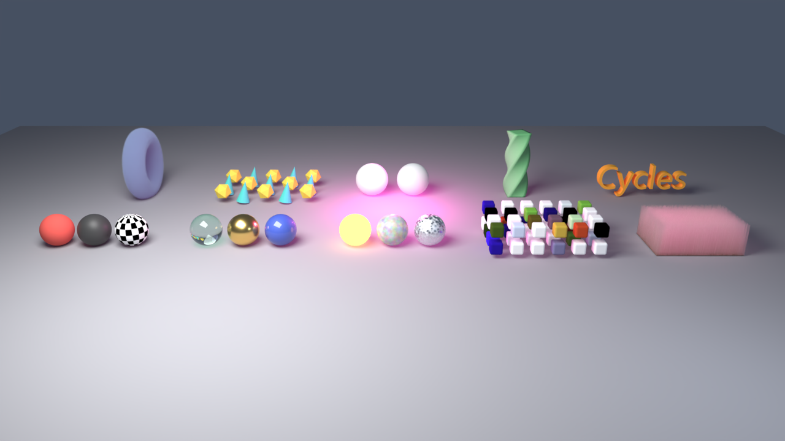

# Example scene

`cycles_render_examples.c4d` shows what Cycles Render translates, in one scene. Open it in Cinema 4D 2027 with the plugin loaded and render it to the Picture Viewer, or open the IPR window (Extensions > Cycles Render IPR) and press Start.

Ten groups stand in two rows; each is named after what it shows.

| Front row, left to right | What it shows |
|---|---|
| Classic Materials | Cinema 4D's own materials: a colour, a reflection, a Checkerboard shader |
| Redshift Materials | Redshift Standard Materials read option by option: glass, a metal, a coated paint |
| Cycles Nodes | Materials of Blender's shader nodes (node space "Cycles"): an Emission node, a Noise Texture as base colour, a Voronoi Texture as roughness |
| MoGraph Cloner | A Cloner with a colour per clone from a Random effector (MoGraph Color shader) |
| Hair | A Hair object |

| Back row, left to right | What it shows |
|---|---|
| Volume | A Volume Builder's fog, shaded by a Cycles Object tag (Volume tab) |
| Instances on a Matrix | A Cycles Object tag (Instances tab) puts two objects on the matrices of a Matrix object, turned by an effector |
| Light Linking | A Cycles Object tag (Light Linking tab) keeps the pink light off the right ball |
| Deformer | A Twist deformer |
| Extruded Text | A text spline in an Extrude generator |

The light is a Redshift area light and a classic point light; the camera is a Redshift camera; the background is the default world of the render settings (Object Settings).

Not in the scene: particles (they need the simulation to run first), a Volume Loader with a .vdb file, a Redshift dome light with a map, and textures from files. All four work; they need files or frames this scene does not carry.

The scene is built by a script: `tools/make_example_scene.py` (its first comment says how to run it). Change the script and run it again instead of editing the file by hand. Redshift must be installed for the Redshift materials.
